<div align="center">

# ⚡ Escriba

**AI writing assistant for Windows, macOS, and Linux, built right into your workflow.**

[](https://github.com/cgarciagl/escriba/actions/workflows/tests.yml)
[](https://github.com/cgarciagl/escriba/releases/latest)


[Download latest release](https://github.com/cgarciagl/escriba/releases/latest) · [Screenshots](#-screenshots) · [How to use](#%EF%B8%8F-how-to-use) · [Settings & Providers](#%EF%B8%8F-settings--providers) · [Development](#%EF%B8%8F-development) · [Español](README.es.md)

</div>

---

**Escriba** runs quietly in the system tray (or menu bar on macOS) and opens from any application via a global shortcut (`Win+Alt+E` on Windows, `⌃⌘E` on macOS, `Ctrl+Alt+E` on Linux — all customizable).

Select text to transform it with built-in actions or free-form instructions — or invoke it **without a selection** to draft from scratch — preview the response live with *streaming*, compare changes line by line, refine iteratively, and replace the original text with a single shortcut.

Bilingual (**English / Spanish**): detects your system language on first launch, lets you switch anytime in **Settings → General**, and ensures AI responses are always returned in your selected language (except explicit translation actions).

Natively compatible with **Google Gemini** (`gemini-3.5-flash-lite`, `2.5-flash`, `2.5-pro`, etc.) and any **OpenAI-compatible** server (**Ollama** locally, LM Studio, OpenAI, OpenRouter…), including automatic provider fallback.

---

## 📸 Screenshots

<table>
  <tr>
    <td align="center" valign="top" width="50%">
      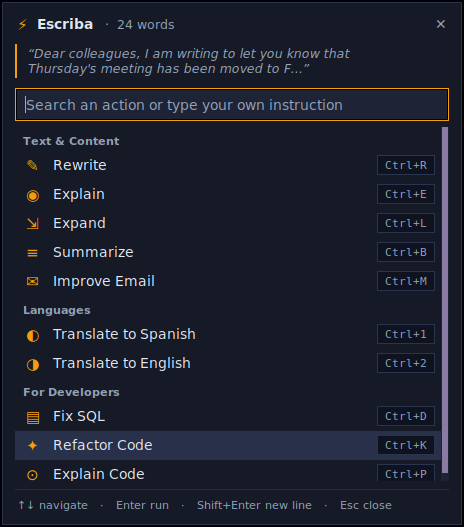<br>
      <sub><b>Command palette</b>: opens near your cursor, with scroll, search, and shortcuts</sub>
    </td>
    <td align="center" valign="top" width="50%">
      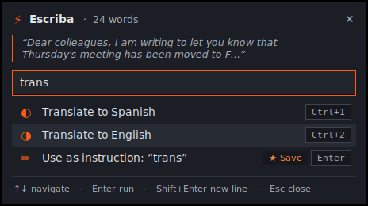<br>
      <sub><b>Instant filtering</b>: accent- and case-insensitive</sub><br><br>
      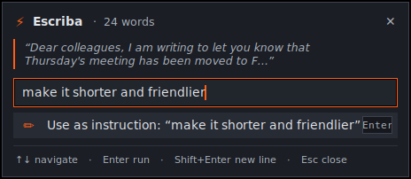<br>
      <sub><b>Custom instruction</b>: any typed text runs as a prompt</sub>
    </td>
  </tr>
  <tr>
    <td align="center" valign="top">
      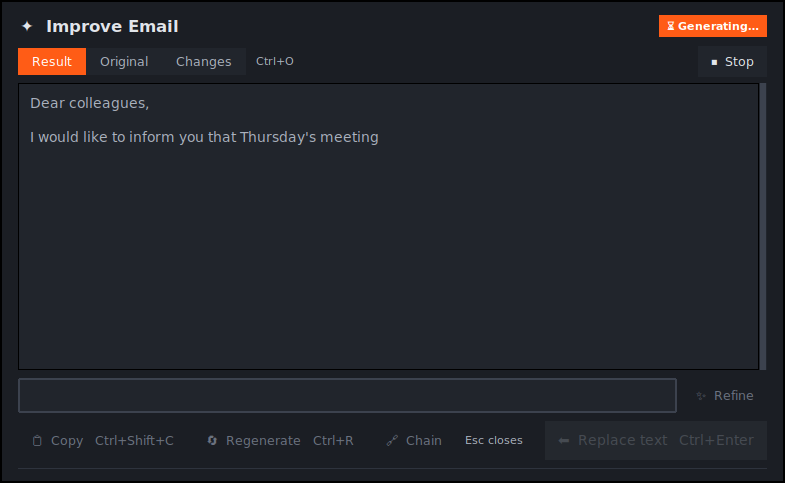<br>
      <sub><b>Live streaming</b>: stop anytime and keep what was generated</sub>
    </td>
    <td align="center" valign="top">
      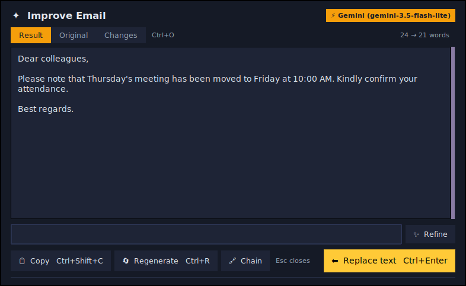<br>
      <sub><b>Result window</b>: replace, compare changes (diff), refine, or copy</sub>
    </td>
  </tr>
  <tr>
    <td align="center" valign="top">
      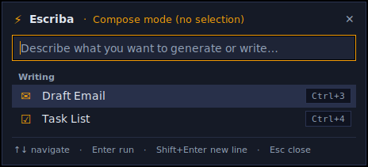<br>
      <sub><b>Compose mode</b>: with no selection, generate content from scratch at your cursor</sub>
    </td>
    <td align="center" valign="top">
      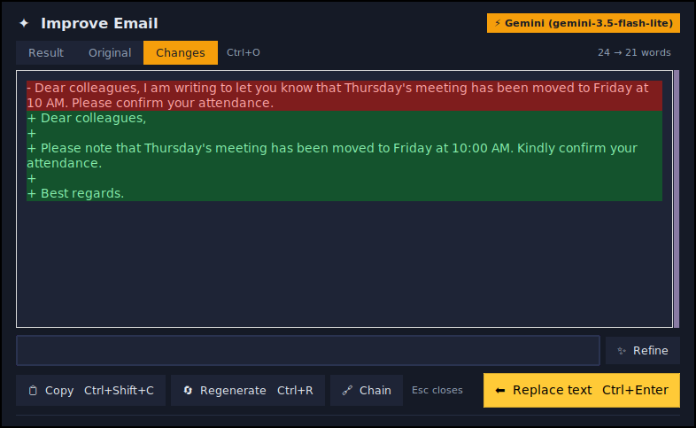<br>
      <sub><b>Changes view</b>: line-by-line diff between original and result</sub>
    </td>
  </tr>
  <tr>
    <td align="center" valign="top">
      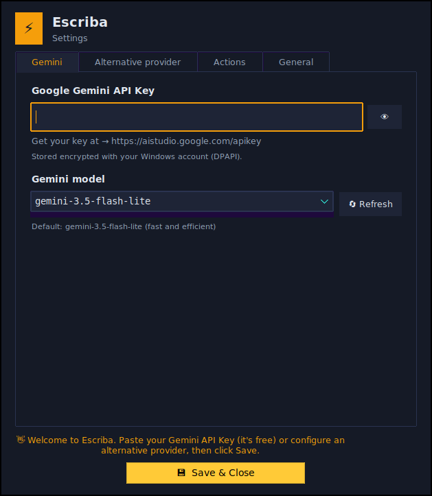<br>
      <sub><b>First launch</b>: guided Gemini setup</sub>
    </td>
    <td align="center" valign="top">
      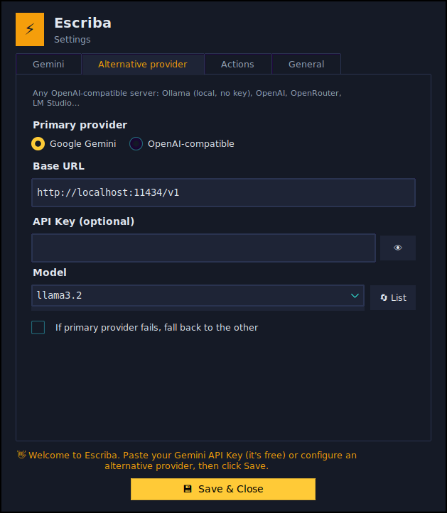<br>
      <sub><b>Alternative provider</b>: Ollama, OpenAI, OpenRouter, LM Studio…</sub><br><br>
      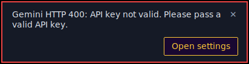<br>
      <sub><b>Actionable errors</b>: direct button to open settings or retry</sub>
    </td>
  </tr>
  <tr>
    <td align="center" valign="top">
      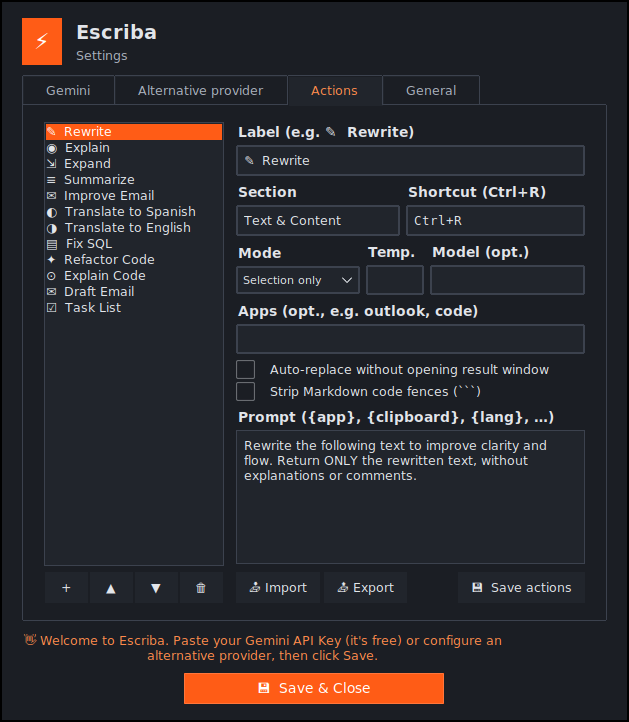<br>
      <sub><b>Action editor</b>: create, reorder, import, and export actions with mode, apps, temperature, and model</sub>
    </td>
    <td align="center" valign="top">
      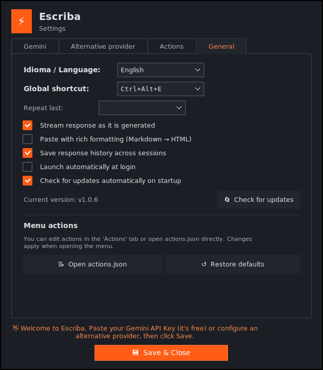<br>
      <sub><b>General settings</b>: language, shortcuts, rich paste, persistent history, and updates</sub>
    </td>
  </tr>
</table>

---

## 🎯 Key Features

### Writing workflow
* 🌐 **Bilingual (English / Spanish)**: auto-detects OS language on first run, switchable in **Settings → General**; AI responses always follow your chosen language.
* ⌨️ **Configurable global shortcut**: `Win+Alt+E` (Windows), `⌃⌘E` (macOS), or `Ctrl+Alt+E` (Linux), plus an optional secondary shortcut to **repeat the last action** without opening the menu.
* ✍️ **With selection or from scratch**: if text is selected, Escriba transforms it; if not, it enters **compose mode** to draft emails, task lists, or anything you ask, pasting right at the cursor.
* 🧩 **Adapts to the active app**: assign actions to specific apps (e.g. Outlook or VS Code) so they automatically promote to the top there.
* ★ **Favorites first**: frequently used actions rise to the top, recent custom prompts are remembered, and you can save any prompt with **★ Save** (`Ctrl+S`/`⌘S`).
* 🔎 **Instant search & free-form prompts**: accent- and case-insensitive filtering, or type any instruction (`Shift+Enter` for multiline).
* ⚡ **Auto-replace**: actions with `auto_replace` enabled paste the result directly without opening the result window.

### Result window
* 📡 **Real-time streaming**, with a **Stop** button that keeps everything generated so far.
* 🔍 **Three views**: **Result** (editable), **Original**, and **Changes** (line-by-line diff), with word count and generation latency.
* ✨ **Iterative refinement**: ask for adjustments on the result ("shorter", "more formal"…) and step back through previous versions with `◀`/`▶`.
* 🔗 **Chain actions**: pass the current result directly into another action (e.g. *Summarize → Translate to Spanish*).
* 📋 **Rich-text paste (optional)**: preserves bold, lists, and headings as HTML when pasting into emails or documents.
* 🕘 **History**: your last 10 responses accessible from the tray icon (optionally persisted across sessions).

### AI & privacy
* 🤖 **Google Gemini** with live model discovery from your account.
* 🔀 **Any OpenAI-compatible provider**: **Ollama** (local, no key required), **LM Studio**, **OpenAI**, **OpenRouter**…, as primary or **automatic fallback**.
* 🔄 **Automatic retries** with exponential backoff when a service is busy.
* 🔒 **Protected secrets**: encrypted with Windows DPAPI, stored in macOS Keychain, or saved with `0600` permissions on Linux. Escriba also preserves non-text clipboard contents.
* 🧩 **Action editor**: create, reorder, import, and export custom actions from *Settings → Actions*.

---

## 📦 Download & Installation

### Option 1: Ready-to-use executable (recommended)

Download the latest release from [GitHub Releases](https://github.com/cgarciagl/escriba/releases/latest):

* **Windows:** `Escriba.exe` (standalone executable, no console window or Python installation required).
* **macOS:** `Escriba-macos.zip` (contains `Escriba.app` for the menu bar).
* **Linux (X11):** `Escriba-linux.tar.gz` (extract with `tar -xzf Escriba-linux.tar.gz && ./Escriba`; requires `xclip` and `xdotool`).

### Option 2: From source

```bash
git clone https://github.com/cgarciagl/escriba.git
cd escriba
pip install -r requirements.txt
python escriba.py
```

On first launch, Escriba creates its config directory, displays the welcome banner, and opens **Settings** if no AI provider is configured yet.

---

## ⌨️ How to Use

1. **Select text** in any application (or place the cursor where you want to draft from scratch).
2. **Press** `Win+Alt+E` (Windows), `⌃⌘E` (macOS), or `Ctrl+Alt+E` (Linux).
3. **Pick an action** by typing to filter, navigating with `↑`/`↓`, or pressing its direct shortcut:

| Section | Action | Shortcut | Description |
| --- | --- | --- | --- |
| **Text & Content** | ✎ Rewrite | `Ctrl+R` | Improves clarity and flow while preserving meaning |
| | ◉ Explain | `Ctrl+E` | Detailed, clear, and structured explanation |
| | ⇲ Expand | `Ctrl+L` | Elaborates coherently without inventing facts |
| | ≡ Summarize | `Ctrl+B` | Executive summary highlighting key points |
| | ✉ Improve Email | `Ctrl+M` | Polishes tone, professionalism, and clarity |
| **Writing** *(no selection)* | ✉ Draft Email | `Ctrl+3` | Writes a full email from a brief idea |
| | ☑ Task List | `Ctrl+4` | Creates an actionable bullet-point list from a goal |
| **Languages** | ◐ Translate to Spanish | `Ctrl+1` | Faithful Spanish translation without commentary |
| | ◑ Translate to English | `Ctrl+2` | Faithful English translation without commentary |
| **For Developers** | ▤ Fix SQL | `Ctrl+D` | Formats SQL queries cleanly and compactly |
| | ✦ Refactor Code | `Ctrl+K` | Applies Clean Code principles without altering behavior |
| | ⊙ Explain Code | `Ctrl+P` | Step-by-step code walkthrough |

> On macOS, menu shortcuts use `⌘` instead of `Ctrl`. Shortcuts avoid `Ctrl+X/S/F/C/V/Z/A` to preserve standard system bindings.

4. **Act on the result:**

| Action | Shortcut (Win·Linux / Mac) | Description |
| --- | --- | --- |
| **⬅️ Replace text** | `Ctrl+Enter` / `⌘↩` | Pastes the result into the source window and restores the clipboard |
| **📋 Copy** | `Ctrl+Shift+C` / `⌘⇧C` | Copies the text (or HTML if `rich_paste` is enabled) |
| **🔄 Regenerate** | `Ctrl+R` / `⌘R` | Generates a new response with the same prompt |
| **🔗 Chain** | **Chain** button | Sends the current result into another action |
| **Switch view** | `Ctrl+O` / `⌘O` | Cycles between *Result*, *Original*, and *Changes (diff)* |
| **✨ Refine** | `Enter` in bottom bar | Sends a follow-up refinement instruction |
| **Close** | `Esc` | Closes the window (and cancels active streaming) |

---

## ⚙️ Settings & Providers

Open **Settings** from the tray icon (left-click, or right-click → **Settings**).

### Google Gemini
1. Get a free API Key at [Google AI Studio](https://aistudio.google.com/apikey).
2. Paste it in the **Gemini** tab (toggle visibility with `👁`).
3. Click **🔄 Refresh** to fetch models available on your account.

### Alternative provider (OpenAI-compatible)
Configure any server exposing `/chat/completions`:

| Provider | Base URL | API Key |
| --- | --- | --- |
| **Ollama (local)** | `http://localhost:11434/v1` | Optional |
| **LM Studio** | `http://localhost:1234/v1` | Optional |
| **OpenAI** | `https://api.openai.com/v1` | Required |
| **OpenRouter** | `https://openrouter.ai/api/v1` | Required |

Enable **"If primary provider fails, fall back to the other"** for automatic fallback (triggers only if the primary fails before streaming text).

### Custom actions
In the **Actions** tab you can create, edit, reorder, import, and export actions. For each one you can configure its prompt, section, shortcut, mode (selection, compose, or both), target apps, temperature, model, and auto-replace behavior.

Prompts support dynamic variables resolved at runtime: `{app}` (active application), `{clipboard}`, `{lang}`, `{date}`, `{time}`, `{datetime}`, and `{input:Label}` (prompts you for a value before running). If you prefer editing the JSON file directly, click **Open actions.json** in the **General** tab.

---

## 🍎 macOS & 🐧 Linux (experimental)

Escriba runs on **macOS 11+** (Apple Silicon & Intel) and **Linux (X11)**.

* **macOS:** on first launch, grant **Accessibility** and **Input Monitoring** permissions under **System Settings → Privacy & Security**.
* **Linux:** requires an **X11** session for global shortcuts and window switching (on **Wayland** a notice is shown with limited support) plus `xclip` and `xdotool` (Debian/Ubuntu: `sudo apt install xclip xdotool python3-tk`).

---

## 🛠️ Development

Want to build, run tests, or contribute? Architecture details, test/build commands, release workflow, and project conventions are documented in [`AGENTS.md`](AGENTS.md).

---

## 📄 Credits

Created by **Carlos García Trujillo**.

Independent cross-platform project (Windows, macOS, and Linux) built with Python, [`ttkbootstrap`](https://ttkbootstrap.readthedocs.io/), [`pystray`](https://pystray.readthedocs.io/), [`Pillow`](https://python-pillow.org/), and the Google Gemini / OpenAI-compatible APIs.
