<div align="center">

# ⚡ Escriba

**Asistente de texto con IA para Windows, macOS y Linux, integrado en tu flujo de escritura.**

[](https://github.com/cgarciagl/escriba/actions/workflows/tests.yml)
[](https://github.com/cgarciagl/escriba/releases/latest)


[Descargar última versión](https://github.com/cgarciagl/escriba/releases/latest) · [Capturas](#-capturas) · [Cómo usar](#%EF%B8%8F-cómo-usar) · [Configuración](#%EF%B8%8F-configuración-y-proveedores) · [Desarrollo](#%EF%B8%8F-desarrollo)

</div>

---

**Escriba** se ejecuta de forma silenciosa en la bandeja del sistema (o barra de menús en macOS) y se activa desde cualquier aplicación mediante un atajo global (`Win+Alt+E` en Windows, `⌃⌘E` en macOS, `Ctrl+Alt+E` en Linux, configurable).

Selecciona un texto para transformarlo con acciones predefinidas o instrucciones libres —o invócalo **sin selección** para redactar desde cero—, previsualiza la respuesta en *streaming*, compara los cambios línea a línea, refínala con ajustes iterativos y sustituye el texto original con un solo atajo.

Compatible de forma nativa con **Google Gemini** (`gemini-3.5-flash-lite`, `2.5-flash`, `2.5-pro`, etc.) y con cualquier servidor compatible con la API de **OpenAI** (**Ollama** en local, LM Studio, OpenAI, OpenRouter…), incluyendo respaldo automático entre proveedores.

---

## 📸 Capturas

<table>
  <tr>
    <td align="center" valign="top" width="50%">
      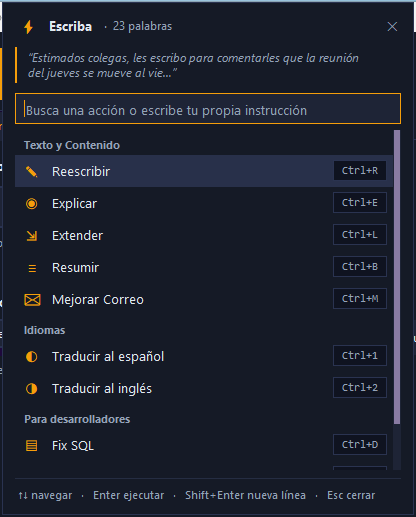<br>
      <sub><b>Paleta de comandos</b>: aparece junto al cursor, con scroll, buscador y atajos</sub>
    </td>
    <td align="center" valign="top" width="50%">
      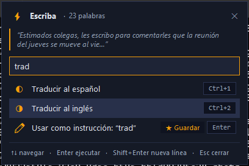<br>
      <sub><b>Filtrado instantáneo</b>: insensible a acentos y mayúsculas</sub><br><br>
      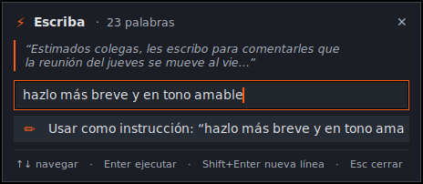<br>
      <sub><b>Instrucción libre</b>: cualquier texto se ejecuta como prompt</sub>
    </td>
  </tr>
  <tr>
    <td align="center" valign="top">
      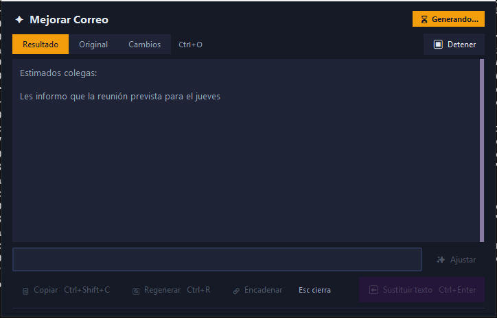<br>
      <sub><b>Streaming en vivo</b>: con botón para detener y conservar lo generado</sub>
    </td>
    <td align="center" valign="top">
      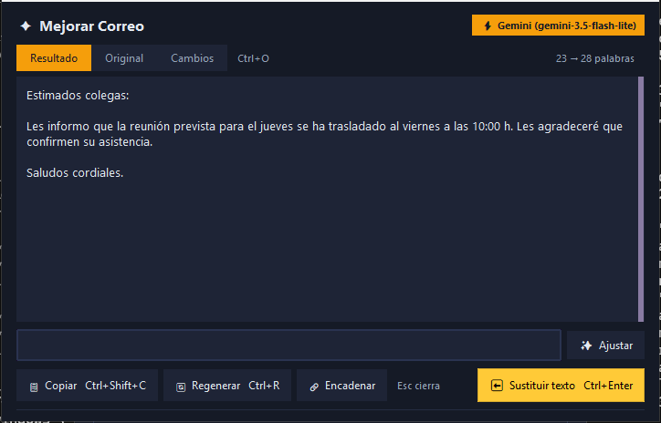<br>
      <sub><b>Ventana de resultado</b>: sustituir, comparar cambios (diff), ajustar o copiar</sub>
    </td>
  </tr>
  <tr>
    <td align="center" valign="top">
      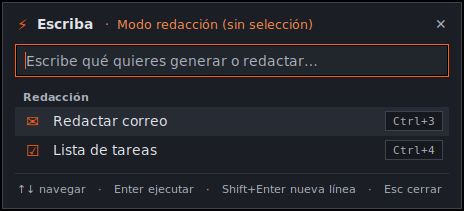<br>
      <sub><b>Modo redacción</b>: sin selección, genera contenido desde cero y lo pega en el cursor</sub>
    </td>
    <td align="center" valign="top">
      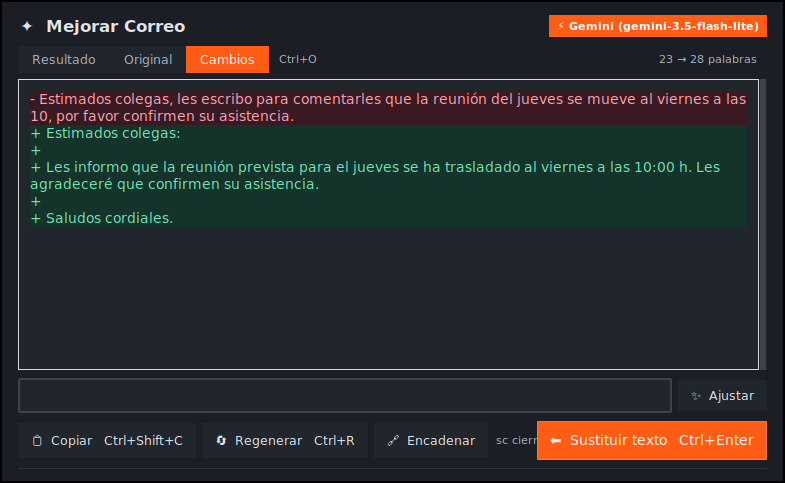<br>
      <sub><b>Vista Cambios</b>: diff línea a línea entre el original y el resultado</sub>
    </td>
  </tr>
  <tr>
    <td align="center" valign="top">
      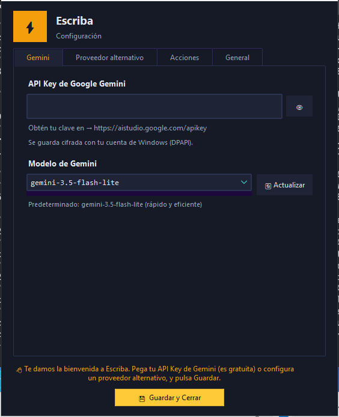<br>
      <sub><b>Primer arranque</b>: configuración guiada de Gemini</sub>
    </td>
    <td align="center" valign="top">
      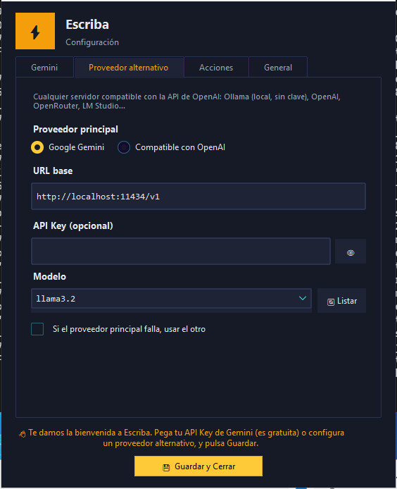<br>
      <sub><b>Proveedor alternativo</b>: Ollama, OpenAI, OpenRouter, LM Studio…</sub><br><br>
      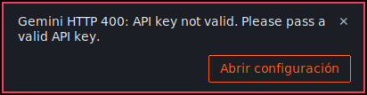<br>
      <sub><b>Errores accionables</b>: botón directo para configurar o reintentar</sub>
    </td>
  </tr>
  <tr>
    <td align="center" valign="top">
      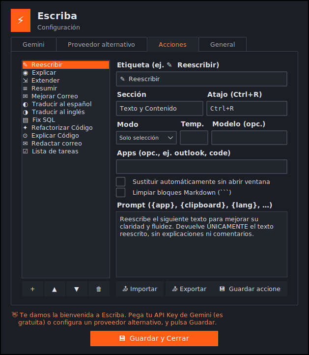<br>
      <sub><b>Editor de acciones</b>: crea, reordena, importa y exporta acciones con modo, apps, temperatura y modelo</sub>
    </td>
    <td align="center" valign="top">
      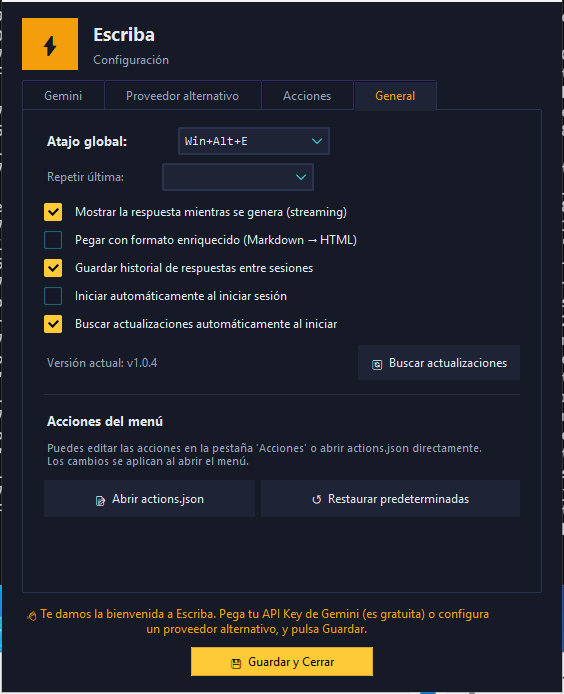<br>
      <sub><b>Ajustes generales</b>: atajos, pegado enriquecido, historial persistente y actualizaciones</sub>
    </td>
  </tr>
</table>

---

## 🎯 Características principales

### Flujo de escritura
* ⌨️ **Atajo global configurable**: `Win+Alt+E` (Windows), `⌃⌘E` (macOS) o `Ctrl+Alt+E` (Linux), más un segundo atajo opcional para **repetir la última acción** sin abrir el menú.
* ✍️ **Con selección o desde cero**: si seleccionas texto, Escriba lo transforma; si no, entra en **modo redacción** para escribir correos, listas de tareas o lo que le pidas, y lo pega donde está el cursor.
* 🧩 **Se adapta a la app activa**: puedes tener acciones que solo aparecen (y suben al principio) en ciertas aplicaciones, como Outlook o VS Code.
* ★ **Tus acciones favoritas primero**: las más usadas suben arriba, recuerda tus últimas instrucciones libres y puedes guardarlas como acción con **★ Guardar** (`Ctrl+S`/`⌘S`).
* 🔎 **Búsqueda instantánea e instrucción libre**: filtra sin importar acentos ni mayúsculas, o escribe cualquier instrucción (`Shift+Enter` para varias líneas).
* ⚡ **Sustitución automática**: las acciones que lo tengan activado pegan el resultado directamente, sin ventana intermedia.

### Ventana de resultados
* 📡 **Respuesta en tiempo real**, con botón **Detener** que conserva lo generado hasta ese momento.
* 🔍 **Tres vistas**: **Resultado** (editable), **Original** y **Cambios** (diferencias línea a línea), con contador de palabras y tiempo de generación.
* ✨ **Ajuste iterativo**: pide cambios sobre el resultado ("más breve", "más formal"…) y vuelve a versiones anteriores con `◀`/`▶`.
* 🔗 **Encadenar acciones**: pasa el resultado a otra acción (por ejemplo, *Resumir → Traducir al inglés*).
* 📋 **Pegado con formato (opcional)**: conserva negritas, listas y encabezados al pegar en correos o documentos.
* 🕘 **Historial**: tus últimas 10 respuestas, accesibles desde el ícono de la bandeja (y, si quieres, guardadas entre sesiones).

### IA y privacidad
* 🤖 **Google Gemini** con la lista de modelos disponibles en tu cuenta.
* 🔀 **Cualquier proveedor compatible con OpenAI**: **Ollama** (local, sin clave), **LM Studio**, **OpenAI**, **OpenRouter**…, como principal o como **respaldo automático** si el otro falla.
* 🔄 **Reintentos automáticos** cuando el servicio está saturado.
* 🔒 **Claves protegidas**: cifradas con tu cuenta de Windows, guardadas en el Llavero en macOS y en un archivo privado en Linux. Escriba también respeta lo que tengas en el portapapeles.
* 🧩 **Editor de acciones**: crea, ordena, importa y exporta tus propias acciones desde *Configuración → Acciones*.

---

## 📦 Descarga e Instalación

### Opción 1: Ejecutable listo para usar (recomendado)

Descarga la última versión desde [GitHub Releases](https://github.com/cgarciagl/escriba/releases/latest):

* **Windows:** `Escriba.exe` (ejecutable autónomo sin consola ni instalación previa de Python).
* **macOS:** `Escriba-macos.zip` (contiene `Escriba.app` para barra de menús).
* **Linux (X11):** `Escriba-linux.tar.gz` (extrae con `tar -xzf Escriba-linux.tar.gz && ./Escriba`; requiere `xclip` y `xdotool`).

### Opción 2: Desde código fuente

```bash
git clone https://github.com/cgarciagl/escriba.git
cd escriba
pip install -r requirements.txt
python escriba.py
```

En el primer arranque, Escriba crea su carpeta de configuración, muestra el banner de bienvenida y abre **Configuración** si aún no hay ningún proveedor listo.

---

## ⌨️ Cómo usar

1. **Selecciona texto** en cualquier aplicación (o sitúa el cursor donde quieras redactar desde cero).
2. **Pulsa** `Win+Alt+E` (Windows), `⌃⌘E` (macOS) o `Ctrl+Alt+E` (Linux).
3. **Elige una acción** escribiendo para filtrar, moviéndote con `↑`/`↓` o usando su atajo directo:

| Sección | Acción | Atajo | Descripción |
| --- | --- | --- | --- |
| **Texto y Contenido** | ✎ Reescribir | `Ctrl+R` | Mejora claridad y fluidez conservando el sentido |
| | ◉ Explicar | `Ctrl+E` | Explicación detallada, clara y estructurada |
| | ⇲ Extender | `Ctrl+L` | Amplía el texto con coherencia sin inventar datos |
| | ≡ Resumir | `Ctrl+B` | Resumen ejecutivo con puntos clave |
| | ✉ Mejorar Correo | `Ctrl+M` | Optimiza tono profesional, cortesía y claridad |
| **Redacción** *(sin selección)* | ✉ Redactar correo | `Ctrl+3` | Redacta un correo completo desde una idea breve |
| | ☑ Lista de tareas | `Ctrl+4` | Crea una lista de pasos claros desde un objetivo |
| **Idiomas** | ◐ Traducir al español | `Ctrl+1` | Traducción fiel al español sin comentarios |
| | ◑ Traducir al inglés | `Ctrl+2` | Traducción fiel al inglés sin comentarios |
| **Para Desarrolladores** | ▤ Fix SQL | `Ctrl+D` | Formatea consultas SQL con estructura compacta |
| | ✦ Refactorizar Código | `Ctrl+K` | Aplica Clean Code sin alterar la lógica |
| | ⊙ Explicar Código | `Ctrl+P` | Análisis paso a paso del código |

> En macOS, los atajos del menú usan `⌘` en lugar de `Ctrl`. Los atajos evitan `Ctrl+X/S/F/C/V/Z/A` por su significado habitual en el sistema.

4. **Interactúa con el resultado:**

| Acción | Atajo (Win·Linux / Mac) | Descripción |
| --- | --- | --- |
| **⬅️ Sustituir texto** | `Ctrl+Enter` / `⌘↩` | Pega el resultado en la ventana de origen y restaura el portapapeles |
| **📋 Copiar** | `Ctrl+Shift+C` / `⌘⇧C` | Copia el texto preservando indentación (o en HTML si `rich_paste` está activo) |
| **🔄 Regenerar** | `Ctrl+R` / `⌘R` | Vuelve a generar con el mismo prompt |
| **🔗 Encadenar** | Botón **Encadenar** | Pasa el resultado actual a otra acción |
| **Alternar vista** | `Ctrl+O` / `⌘O` | Alterna entre *Resultado*, *Original* y *Cambios (diff)* |
| **✨ Ajustar** | `Enter` en la barra inferior | Envía una instrucción de refinamiento sobre el resultado actual |
| **Cerrar** | `Esc` | Cierra la ventana (y cancela si estaba en *streaming*) |

---

## ⚙️ Configuración y Proveedores

Abre **Configuración** desde el ícono de la bandeja (clic izquierdo, o clic derecho → **Configuración**).

### Google Gemini
1. Obtén una API Key gratuita en [Google AI Studio](https://aistudio.google.com/apikey).
2. Pégala en la pestaña **Gemini** (puedes verificarla con el botón `👁`).
3. Usa **🔄 Actualizar** para consultar los modelos disponibles en tu cuenta.

### Proveedor alternativo (compatible con OpenAI)
Configura cualquier servidor con `/chat/completions`:

| Proveedor | URL base | API Key |
| --- | --- | --- |
| **Ollama (local)** | `http://localhost:11434/v1` | Opcional |
| **LM Studio** | `http://localhost:1234/v1` | Opcional |
| **OpenAI** | `https://api.openai.com/v1` | Sí |
| **OpenRouter** | `https://openrouter.ai/api/v1` | Sí |

Activa **"Si el proveedor principal falla, usar el otro"** para habilitar el *fallback* automático (solo se activa si el primero falla antes de emitir texto).

### Acciones personalizadas
En la pestaña **Acciones** puedes crear, editar, reordenar, importar y exportar acciones. Para cada una eliges su prompt, sección, atajo, si funciona con selección, sin ella o en ambos casos, en qué aplicaciones aparece y si debe sustituir el texto automáticamente.

Los prompts admiten variables que se rellenan al ejecutarlos: `{app}` (aplicación activa), `{clipboard}`, `{lang}`, `{date}`, `{time}`, `{datetime}` y `{input:Etiqueta}` (te pide un valor antes de ejecutar). Si prefieres editar el archivo a mano, usa **Abrir actions.json** en la pestaña **General**.

---

## 🍎 macOS y 🐧 Linux (experimental)

Escriba funciona en **macOS 11+** (Apple Silicon e Intel) y **Linux (X11)**.

* **macOS:** la primera vez pedirá permisos en **Ajustes del Sistema → Privacidad y seguridad** (**Accesibilidad** y **Monitorización de entrada**).
* **Linux:** necesita una sesión **X11** para el atajo global y el cambio de ventanas (en **Wayland** muestra un aviso y funciona de forma limitada) y los paquetes `xclip` y `xdotool` (en Debian/Ubuntu: `sudo apt install xclip xdotool python3-tk`).

---

## 🛠️ Desarrollo

¿Quieres compilar, ejecutar las pruebas o contribuir? La arquitectura, los comandos de prueba y compilación, el proceso de publicación y las convenciones del proyecto están en [`AGENTS.md`](AGENTS.md).

---

## 📄 Créditos

Proyecto independiente multiplataforma (Windows, macOS y Linux) desarrollado con Python, [`ttkbootstrap`](https://ttkbootstrap.readthedocs.io/), [`pystray`](https://pystray.readthedocs.io/), [`Pillow`](https://python-pillow.org/) y las APIs de Google Gemini / OpenAI-compatible.
