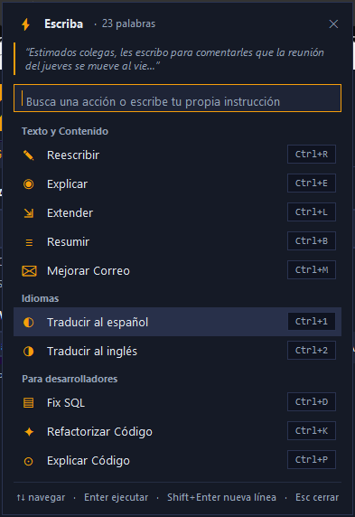
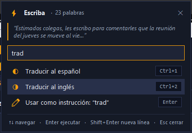
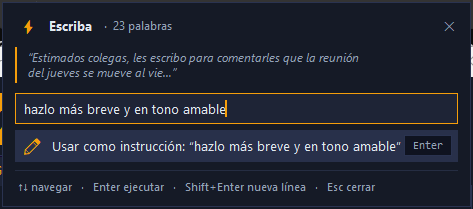
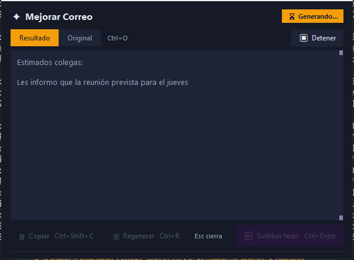
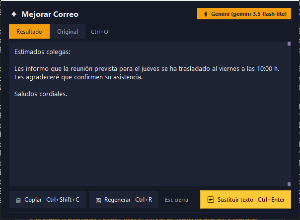
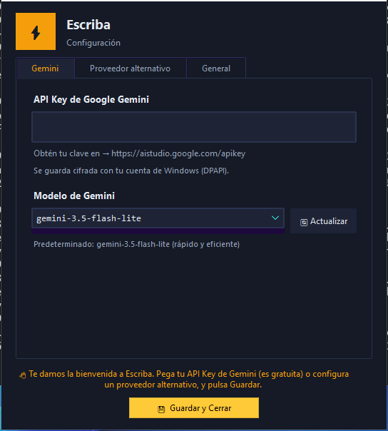
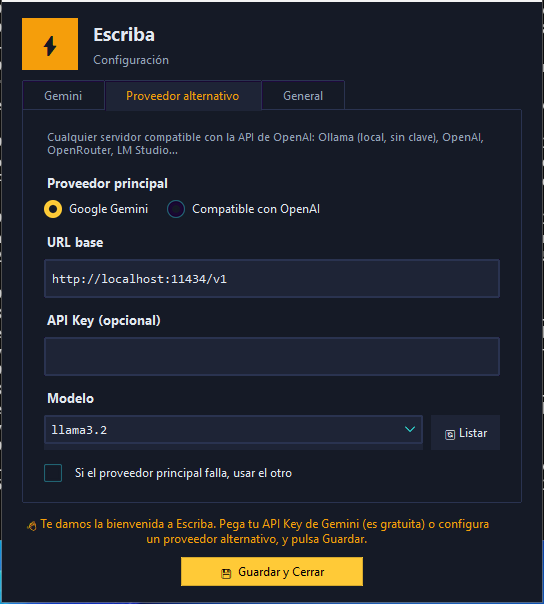
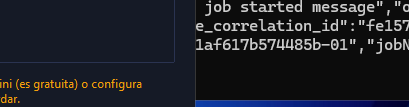

<div align="center">

# ⚡ Escriba

**Asistente de texto con IA para Windows, macOS y Linux, integrado en tu flujo de escritura.**

[](https://github.com/cgarciagl/escriba/actions/workflows/tests.yml)
[](https://github.com/cgarciagl/escriba/releases/latest)


[Descargar última versión](https://github.com/cgarciagl/escriba/releases/latest) · [Capturas](#-capturas) · [Cómo usar](#%EF%B8%8F-cómo-usar) · [Configuración](#%EF%B8%8F-configuración-y-proveedores) · [Desarrollo](#%EF%B8%8F-compilar-y-probar)

</div>

---

**Escriba** se ejecuta de forma silenciosa en la bandeja del sistema (o barra de menús en macOS) y se activa desde cualquier aplicación mediante un atajo global (`Win+Alt+E` en Windows, `⌃⌘E` en macOS, `Ctrl+Alt+E` en Linux, configurable).

Selecciona un texto para transformarlo con acciones predefinidas o instrucciones libres —o invócalo **sin selección** para redactar desde cero—, previsualiza la respuesta en *streaming*, compara los cambios línea a línea, refínala con ajustes iterativos y sustituye el texto original con un solo atajo.

Compatible de forma nativa con **Google Gemini** (`gemini-3.5-flash-lite`, `2.5-flash`, `2.5-pro`, etc.) y con cualquier servidor compatible con la API de **OpenAI** (**Ollama** en local, LM Studio, OpenAI, OpenRouter…), incluyendo respaldo automático entre proveedores.

---

## 📸 Capturas

<table>
  <tr>
    <td align="center" valign="top" width="50%">
      <br>
      <sub><b>Paleta de comandos</b>: aparece junto al cursor, con scroll, buscador y atajos</sub>
    </td>
    <td align="center" valign="top" width="50%">
      <br>
      <sub><b>Filtrado instantáneo</b>: insensible a acentos y mayúsculas</sub><br><br>
      <br>
      <sub><b>Instrucción libre</b>: cualquier texto se ejecuta como prompt</sub>
    </td>
  </tr>
  <tr>
    <td align="center" valign="top">
      <br>
      <sub><b>Streaming en vivo</b>: con botón para detener y conservar lo generado</sub>
    </td>
    <td align="center" valign="top">
      <br>
      <sub><b>Ventana de resultado</b>: sustituir, comparar cambios (diff), ajustar o copiar</sub>
    </td>
  </tr>
  <tr>
    <td align="center" valign="top">
      <br>
      <sub><b>Primer arranque</b>: configuración guiada de Gemini</sub>
    </td>
    <td align="center" valign="top">
      <br>
      <sub><b>Proveedor alternativo</b>: Ollama, OpenAI, OpenRouter, LM Studio…</sub><br><br>
      <br>
      <sub><b>Errores accionables</b>: botón directo para configurar o reintentar</sub>
    </td>
  </tr>
</table>

> Las capturas de Windows se generan automáticamente con `tools/capturas.py` en cada ejecución de CI (artefacto `capturas`).

---

## 🎯 Características principales

### Flujo de escritura y paleta de comandos
* ⌨️ **Atajo global configurable**: `Win+Alt+E` (Windows) / `⌃⌘E` (macOS) / `Ctrl+Alt+E` (Linux) por defecto; personalizable desde *Configuración → General* sin reiniciar la app.
* ✍️ **Modo con selección y modo redacción**: si hay texto seleccionado, ofrece acciones sobre él; si no hay selección, se abre en **modo redacción** para generar contenido desde cero y pegarlo directamente en el cursor.
* ★ **Acciones frecuentes y scroll completo**: promueve arriba tus acciones más usadas y permite desplazarse por toda la lista con ratón o teclado (`↑`/`↓`).
* 🔎 **Búsqueda instantánea e instrucción libre**: filtra sin importar acentos ni mayúsculas o escribe cualquier instrucción ad hoc (`Shift+Enter` para multilínea).
* ⚡ **Auto-sustitución (`auto_replace`)**: las acciones marcadas como automáticas pegan el resultado directamente en la app de origen al terminar, sin abrir ventana intermedia.
* 📏 **Aviso de texto largo**: indica en el encabezado cuando el texto supera los 10 000 caracteres.

### Ventana de resultados e iteración
* 📡 **Streaming en tiempo real** con botón **Detener** (conservando lo generado hasta ese momento) y cancelación limpia al cerrar la ventana.
* 🔍 **Tres vistas**: **Resultado** (editable, con resaltado ligero de Markdown para títulos, **negritas** y código), **Original** y **Cambios** (*diff* línea a línea en rojo/verde).
* ✨ **Ajuste iterativo**: barra inferior **"Ajustar"** para pedir modificaciones sobre la respuesta actual (*"más corto"*, *"tono más formal"*, etc.).
* 🕘 **Historial en memoria**: últimas 10 respuestas de la sesión accesibles desde la bandeja, recordando el proveedor y modelo exactos que las generaron.

### Motores de IA y seguridad
* 🤖 **Google Gemini oficial**: descarga dinámica de modelos compatibles (`gemini-3.5-flash-lite`, `2.5-flash`, `2.5-pro`, etc.) con detección real de errores de clave o red.
* 🔀 **Proveedor alternativo compatible con OpenAI**: soporte para **Ollama** (local, sin clave), **LM Studio**, **OpenAI**, **OpenRouter**, etc., como principal o como **fallback automático**.
* 🔄 **Reintentos inteligentes**: retroceso exponencial con *jitter* ante saturación o límites de tasa (HTTP `429`, `500`, `502`, `503`, `504`).
* 🔒 **Almacenamiento seguro de claves**: cifrado con **DPAPI** en Windows, **Llavero** en macOS (vía `security -i` sin exponer secretos en argumentos de proceso) y `config.json` con permisos restringidos `0600` en Linux, con escritura atómica protegida entre hilos.
* 🧩 **Editor visual de acciones**: pestaña dedicada en *Configuración → Acciones* para crear, reordenar, editar y eliminar acciones (con soporte para variables `{clipboard}` y `{lang}`), además de edición directa de `actions.json`.

---

## 📦 Descarga e Instalación

### Opción 1: Ejecutable listo para usar (recomendado)

Descarga la última versión desde [GitHub Releases](https://github.com/cgarciagl/escriba/releases/latest):

* **Windows:** `Escriba.exe` (ejecutable autónomo sin consola ni instalación previa de Python).
* **macOS:** `Escriba-macos.zip` (contiene `Escriba.app` para barra de menús).
* **Linux (X11):** `Escriba-linux.tar.gz` (extrae con `tar -xzf Escriba-linux.tar.gz && ./Escriba`; requiere `xclip` y `xdotool`).

### Opción 2: Desde código fuente

```bash
git clone https://github.com/cgarciagl/escriba.git
cd escriba
pip install -r requirements.txt
python escriba.py
```

En el primer arranque, Escriba crea su carpeta de configuración, muestra el banner de bienvenida y abre **Configuración** si aún no hay ningún proveedor listo.

---

## ⌨️ Cómo usar

1. **Selecciona texto** en cualquier aplicación (o sitúa el cursor donde quieras redactar desde cero).
2. **Pulsa** `Win+Alt+E` (Windows), `⌃⌘E` (macOS) o `Ctrl+Alt+E` (Linux).
3. **Elige una acción** escribiendo para filtrar, moviéndote con `↑`/`↓` o usando su atajo directo:

| Sección | Acción | Atajo | Descripción |
| --- | --- | --- | --- |
| **Texto y Contenido** | ✎ Reescribir | `Ctrl+R` | Mejora claridad y fluidez conservando el sentido |
| | ◉ Explicar | `Ctrl+E` | Explicación detallada, clara y estructurada |
| | ⇲ Extender | `Ctrl+L` | Amplía el texto con coherencia sin inventar datos |
| | ≡ Resumir | `Ctrl+B` | Resumen ejecutivo con puntos clave |
| | ✉ Mejorar Correo | `Ctrl+M` | Optimiza tono profesional, cortesía y claridad |
| **Idiomas** | ◐ Traducir al español | `Ctrl+1` | Traducción fiel al español sin comentarios |
| | ◑ Traducir al inglés | `Ctrl+2` | Traducción fiel al inglés sin comentarios |
| **Para Desarrolladores** | ▤ Fix SQL | `Ctrl+D` | Formatea consultas SQL con estructura compacta |
| | ✦ Refactorizar Código | `Ctrl+K` | Aplica Clean Code sin alterar la lógica |
| | ⊙ Explicar Código | `Ctrl+P` | Análisis paso a paso del código |

> En macOS, los atajos del menú usan `⌘` en lugar de `Ctrl`. Los atajos evitan `Ctrl+X/S/F/C/V/Z/A` por su significado habitual en el sistema.

4. **Interactúa con el resultado:**

| Acción | Atajo (Win·Linux / Mac) | Descripción |
| --- | --- | --- |
| **⬅️ Sustituir texto** | `Ctrl+Enter` / `⌘↩` | Pega el resultado en la ventana de origen y restaura el portapapeles |
| **📋 Copiar** | `Ctrl+Shift+C` / `⌘⇧C` | Copia el texto preservando indentación |
| **🔄 Regenerar** | `Ctrl+R` / `⌘R` | Vuelve a generar con el mismo prompt |
| **Alternar vista** | `Ctrl+O` / `⌘O` | Alterna entre *Resultado*, *Original* y *Cambios (diff)* |
| **✨ Ajustar** | `Enter` en la barra inferior | Envía una instrucción de refinamiento sobre el resultado actual |
| **Cerrar** | `Esc` | Cierra la ventana (y cancela si estaba en *streaming*) |

---

## ⚙️ Configuración y Proveedores

Abre **Configuración** haciendo clic derecho en el ícono de la bandeja → **Configuración** (o clic izquierdo por defecto).

### Google Gemini
1. Obtén una API Key gratuita en [Google AI Studio](https://aistudio.google.com/apikey).
2. Pégala en la pestaña **Gemini** (puedes verificarla con el botón `👁`).
3. Usa **🔄 Actualizar** para consultar los modelos disponibles en tu cuenta.

### Proveedor alternativo (compatible con OpenAI)
Configura cualquier servidor con `/chat/completions`:

| Proveedor | URL base | API Key |
| --- | --- | --- |
| **Ollama (local)** | `http://localhost:11434/v1` | Opcional |
| **LM Studio** | `http://localhost:1234/v1` | Opcional |
| **OpenAI** | `https://api.openai.com/v1` | Sí |
| **OpenRouter** | `https://openrouter.ai/api/v1` | Sí |

Activa **"Si el proveedor principal falla, usar el otro"** para habilitar el *fallback* automático (solo se activa si el primero falla antes de emitir texto).

### Acciones personalizadas (`Acciones` / `actions.json`)
Puedes gestionarlas desde la pestaña **Acciones** en Configuración o editando directamente `actions.json` (`%APPDATA%\Escriba\actions.json` en Windows, `~/Library/Application Support/Escriba/actions.json` en macOS, `~/.config/Escriba/actions.json` en Linux):

```json
[
  {
    "label": "✎  Reescribir",
    "prompt": "Reescribe el siguiente texto para mejorar su claridad y fluidez.",
    "section": "Texto y Contenido",
    "shortcut": "Ctrl+R",
    "auto_replace": false
  }
]
```

* **Variables en prompts:** `{clipboard}` inserta el contenido actual del portapapeles y `{lang}` el código de idioma del sistema.
* **`auto_replace`:** si es `true`, sustituye el texto en la aplicación de origen automáticamente al terminar la generación.

### Configuración persistente (`config.json`)
Se almacena en `%APPDATA%\Escriba\config.json` (Windows), `~/Library/Application Support/Escriba/config.json` (macOS) o `~/.config/Escriba/config.json` (Linux, con permisos `0600`):

| Clave | Tipo | Descripción |
| --- | --- | --- |
| `api_key_enc` / `api_key_keychain` | string / bool | API Key de Gemini (cifrada con DPAPI en Windows o marcada en Llavero en macOS) |
| `model` | string | Modelo de Gemini seleccionado (por defecto: `gemini-3.5-flash-lite`) |
| `provider` | string | Proveedor principal: `"gemini"` u `"openai"` |
| `fallback_enabled` | boolean | Habilita respaldo automático al proveedor secundario |
| `openai_base_url` / `openai_model` | string | URL base y modelo del proveedor alternativo |
| `openai_api_key_enc` | string | API Key del proveedor alternativo (DPAPI / Llavero) |
| `hotkey` | string | Atajo global personalizado (p. ej. `"Win+Alt+E"`, `"Ctrl+Alt+K"`) |
| `streaming` | boolean | Mostrar respuesta mientras se genera (por defecto: `true`) |
| `autostart` | boolean | Inicio automático al iniciar sesión (por defecto: `false`) |
| `action_usage` | object | Contadores de uso para promover acciones frecuentes |

---

## 🍎 macOS y 🐧 Linux (experimental)

Escriba es compatible con **macOS 11+** (Apple Silicon e Intel) y **Linux (X11)**. La CI ejecuta la suite de pruebas completa y compila los artefactos para Windows, macOS y Linux.

| Aspecto | Windows | macOS | Linux (X11) |
| --- | --- | --- | --- |
| Atajo global por defecto | `Win+Alt+E` | `⌃⌘E` (`Ctrl+Cmd+E`) | `Ctrl+Alt+E` |
| Portapapeles / Pegado | WinAPI + `keyboard` | Quartz (`CGEvent`) | `pynput` + `xclip` |
| Ventana activa | WinAPI (`AttachThreadInput`) | `NSWorkspace` / `NSRunningApplication` | `xdotool` |
| Secretos | DPAPI (`crypt32.dll`) | Llavero (`security -i`) | `config.json` (`chmod 0600`) |
| Inicio automático | Registro `HKCU\...\Run` | `~/Library/LaunchAgents/com.cgarciagl.escriba.plist` | `~/.config/autostart/escriba.desktop` |

* **macOS:** la primera vez solicitará permisos en **Ajustes del Sistema → Privacidad y seguridad** (**Accesibilidad** y **Monitorización de entrada**).
* **Linux:** requiere una sesión **X11** (en Wayland los atajos globales y el foco entre ventanas no están soportados) y tener instalados `xclip` y `xdotool` (en Debian/Ubuntu: `sudo apt install xclip xdotool python3-tk`).

---

## 🛠️ Compilar y Probar

### Requisitos de desarrollo

```bash
pip install -r requirements-dev.txt
```

### Ejecutar pruebas

```bash
# Tests de lógica (multiplataforma)
python -m pytest -q -rf --ignore=tests/test_ui.py

# Tests de interfaz (requiere Tk real; en Linux sin display usa xvfb-run -a)
python -m pytest -q -rf tests/test_ui.py
```

### Compilar ejecutable / bundle

```bash
pyinstaller Escriba.spec --clean --noconfirm
```

* En **Windows** genera `dist\Escriba.exe`.
* En **macOS** genera `dist/Escriba.app`.
* En **Linux** genera `dist/Escriba`.

### Publicar una nueva versión

Al subir un tag con prefijo `v*` (por ejemplo `git tag v0.0.6 && git push origin v0.0.6`), el workflow [`.github/workflows/tests.yml`](.github/workflows/tests.yml) ejecuta todas las pruebas, compila los tres binarios y crea automáticamente la Release en GitHub con `Escriba.exe`, `Escriba-macos.zip` y `Escriba-linux.tar.gz`.

---

## 🗂️ Estructura del Proyecto

```text
escriba/
├── escriba.py          # Orquestador principal: hotkey, tray, captura y ciclo de vida
├── Escriba.spec        # Especificación PyInstaller (Windows .exe, macOS .app, Linux)
├── constants.py        # Versión, rutas base, modelos y acciones predeterminadas
├── config.py           # ConfigManager (thread-safe, escritura atómica, DPAPI/Llavero)
├── actions.py          # Validación, guardado, filtrado y variables de actions.json
├── history.py          # Historial en memoria acotado y seguro entre hilos
├── ai_clients.py       # GeminiClient, OpenAICompatibleClient, SSE streaming y reintentos
├── plataforma.py       # Capa de abstracción Windows / macOS / Linux
├── hotkey.py           # Windows: RegisterHotKey configurable y helpers de teclado
├── startup.py          # Windows: arranque automático en Registro HKCU
├── macos.py            # macOS: pynput, Quartz, NSWorkspace, LaunchAgent y Llavero
├── linux_platform.py   # Linux (X11): pynput, xdotool y autostart .desktop
├── tray.py             # Ícono y menú dinámico en bandeja / barra de menús
├── ui_windows.py       # Fachada de módulos de interfaz
├── ui_common.py        # Paleta oscura, estilos ttk, DPI awareness y notificaciones
├── ui_menu.py          # Paleta de comandos con scroll, modo redacción y frecuentes
├── ui_result.py        # Ventana de resultados: streaming, diff, Markdown y ajuste
├── ui_config.py        # Configuración por pestañas y editor visual de acciones
├── tests/              # Suite automatizada con pytest (lógica + Tk)
├── tools/capturas.py   # Generación automática de capturas para documentación
└── .github/workflows/  # CI/CD: tests, builds y publicación de Releases
```

---

## 📄 Créditos

Proyecto independiente multiplataforma (Windows, macOS y Linux) desarrollado con Python, [`ttkbootstrap`](https://ttkbootstrap.readthedocs.io/), [`pystray`](https://pystray.readthedocs.io/), [`Pillow`](https://python-pillow.org/) y las APIs de Google Gemini / OpenAI-compatible.
